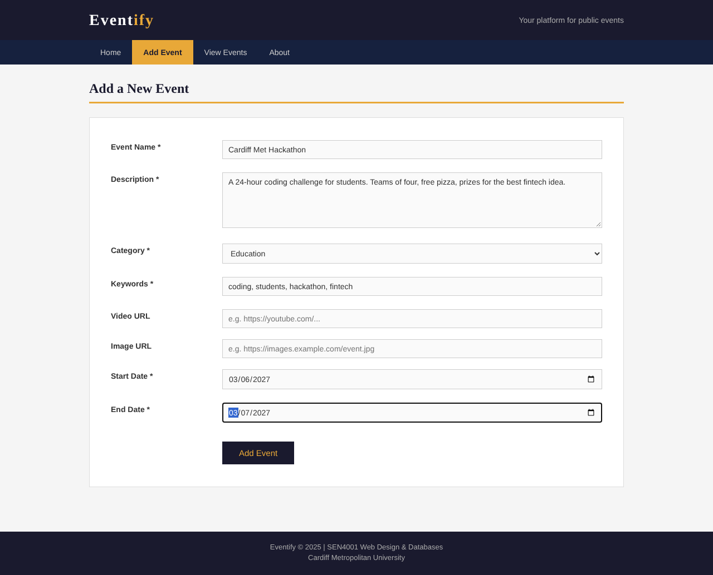
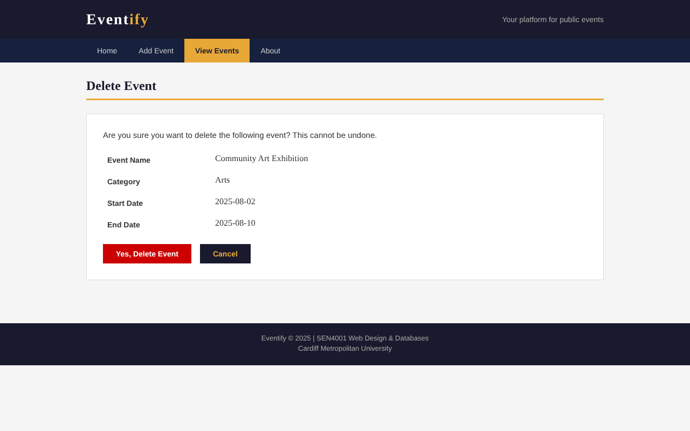

# Eventify

An events website where you can add, view, edit and delete events. It's PHP and MySQL, built for my SEN4001 Web Design & Databases module at Cardiff Met.

## What it does

You fill in a form with the event name, description, category, dates and an optional image or video link, and it shows up on the events page as a card. Events can be edited or deleted afterwards (deleting asks you to confirm first). The form is checked twice, once in the browser with JavaScript and again in PHP, because the JavaScript check is easy to get around.

## Built with

HTML, CSS and JavaScript on the front end, PHP 8 and MySQL on the back end. I ran it locally with XAMPP.

## Running it

1. Install [XAMPP](https://www.apachefriends.org/) and start Apache and MySQL.
2. Put this folder in `C:\xampp\htdocs\eventify`.
3. In phpMyAdmin, import `eventify_db.sql`. That creates the database with a few sample events.
4. Go to `http://localhost/eventify/`.

It connects as `root` with no password, which is the XAMPP default. If your setup is different you can set `EVENTIFY_DB_HOST`, `EVENTIFY_DB_NAME`, `EVENTIFY_DB_USER` and `EVENTIFY_DB_PASS` instead of editing the code.

## Fixing the security after submitting

The version I handed in built its SQL by sticking form input straight into the query string. That meant SQL injection was possible, and an event called "Fred's Party" crashed it because of the apostrophe. It also printed user input back onto the page as-is, so someone could save a `<script>` and it would run for everyone.

After the module I went back and fixed it:

- every query now uses prepared statements with `?` placeholders
- everything printed to the page goes through `htmlspecialchars()`
- image and video links have to start with http or https
- deleting needs a POST from the confirm button, so a link can't delete anything
- the database details live in one file, `db.php`, instead of being copied into four pages

There's no login, so no passwords are stored. If I add accounts I'll use `password_hash()` and `password_verify()`.

## Screenshots

| Home | Add event |
|---|---|
|  |  |

| All events | Delete confirmation |
|---|---|
|  |  |

## Next

User accounts, so organisers can only edit their own events. After that, search and filtering, and proper image uploads instead of pasting links.
